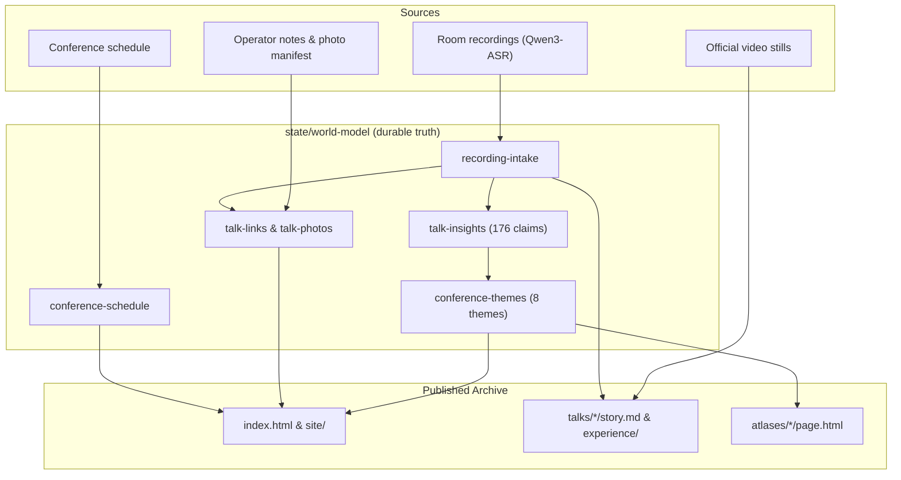

# AI Engineer New York 2026 — Public Archive

**Live Archive:** **[https://the-focus-ai.github.io/ai-engineer-nyc-2026-oct/](https://the-focus-ai.github.io/ai-engineer-nyc-2026-oct/)**

Field guide, cross-talk synthesis, scrollytelling talk stories, stage slides, and verbatim evidence from **AI Engineer New York 2026** (October 12–14, 2026 · New York Marriott Marquis), compiled and published by **[TheFocus.AI](https://thefocus.ai)**.

## Explore the Archive

- **[Themes Explorer (Front Page)](https://the-focus-ai.github.io/ai-engineer-nyc-2026-oct/)** — Interactive synthesis of all 8 architectural shifts, 5 contested fault lines, and 176 verbatim claim atoms.
- **[Guided Summit Presentation](https://the-focus-ai.github.io/ai-engineer-nyc-2026-oct/atlases/conference-themes/page.html)** — Scrollytelling walkthrough of the conference's overarching thesis with stage slides and speaker quotes.
- **[Talks Directory](https://the-focus-ai.github.io/ai-engineer-nyc-2026-oct/site/talks/index.html)** — 31 scrollytelling talk stories paired with official video stills, verified dossiers, and full Qwen3-ASR transcripts (plus 1 photo-captured workshop).
- **[Full Conference Schedule](https://the-focus-ai.github.io/ai-engineer-nyc-2026-oct/site/schedule.html)** & **[Interactive Field Guide](https://the-focus-ai.github.io/ai-engineer-nyc-2026-oct/site/index.html)** — All 167 sessions across 4 days and 161 speakers.
- **[Speaker Roster](https://the-focus-ai.github.io/ai-engineer-nyc-2026-oct/site/people.html)** — Every speaker, session link, and social handle.

## Corpus Snapshot

| Metric | Count | Source of Truth |
| --- | --- | --- |
| Schedule sessions | **167** (Oct 11–14, 2026 · 161 speakers) | `state/world-model/conference-schedule/published/` |
| Recorded & transcribed talks | **31** (**95,224** Qwen3-ASR words) | `talks/*/transcript.md` |
| Scrollytelling talk stories | **31** (with extracted stage slides) | `talks/*/story.md`, `talks/*/experience/page.html` |
| Verbatim claim atoms | **176** (anchored to transcript timestamps) | `state/world-model/talk-insights/published/claims.json` |
| Synthesized themes & atlases | **8** theme deep dives + **1** master atlas | `analysis/themes.md`, `atlases/*/page.html` |
| Contested fault lines | **5** multi-speaker architectural debates | `state/world-model/conference-themes/published/contested.json` |

## The 8 Architectural Shifts

1. **[Verification Loops & Continuous Agent Evaluation](https://the-focus-ai.github.io/ai-engineer-nyc-2026-oct/atlases/verification-loops-and-continuous-evals/page.html)** *(15 talks)* — Because code generation is cheap and non-deterministic, engineering effort moves into closed-loop verifiers, backwards-built golden datasets, and trajectory-level grading.
2. **[Thin Harnesses & Giving the Model a Computer](https://the-focus-ai.github.io/ai-engineer-nyc-2026-oct/atlases/thin-harnesses-and-agent-sandboxes/page.html)** *(12 talks)* — Rigid multi-step DAGs and bloated tool wrappers are collapsing into thin loops running inside isolated Linux sandboxes with bash and filesystem access.
3. **[Context Hygiene, Graph Memory & Skill Self-Improvement](https://the-focus-ai.github.io/ai-engineer-nyc-2026-oct/atlases/context-hygiene-and-skill-memory/page.html)** *(10 talks)* — Stuffing static markdown manuals into context degrades reasoning; production agents curate context dynamically and rewrite their own skills from execution traces.
4. **[Policy-Driven Governance & Financial-Grade Guardrails](https://the-focus-ai.github.io/ai-engineer-nyc-2026-oct/atlases/enterprise-governance-and-financial-ai/page.html)** *(8 talks)* — Regulated institutions ship autonomous agents by replacing manual gates and prompt rules with runtime entitlement registries, deterministic policy DSLs, and audited provenance.
5. **[The Agent Manager Role & AI-Native Organizations](https://the-focus-ai.github.io/ai-engineer-nyc-2026-oct/atlases/agent-managers-and-org-redesign/page.html)** *(9 talks)* — Individual contributors become fleet managers orchestrating parallel agents, forcing organizations to redesign workflows around verification throughput rather than headcount.
6. **[Tokenomics, Model Right-Sizing & Open Foundations](https://the-focus-ai.github.io/ai-engineer-nyc-2026-oct/atlases/tokenomics-right-sizing-and-open-foundations/page.html)** *(7 talks)* — Frontier APIs burn margin at production scale; teams cut unit costs 10x–20x via KV-cache-friendly routing, live vLLM benchmarking, and fine-tuned open-weight models.
7. **[Temporal Grounding, Backtesting & World Simulation](https://the-focus-ai.github.io/ai-engineer-nyc-2026-oct/atlases/world-models-simulation-and-temporal-data/page.html)** *(5 talks)* — Next-generation systems move beyond static text into spatiotemporally grounded world models, interactive pixel simulations, and point-in-time web archives that eliminate lookahead leakage.
8. **[Agentic Commerce & Programmable Payment Rails](https://the-focus-ai.github.io/ai-engineer-nyc-2026-oct/atlases/agentic-commerce-and-payment-rails/page.html)** *(3 talks)* — Autonomous tool consumption requires replacing human checkout flows and API-key silos with scoped programmatic payment authorization (`x402`, MPP, and virtual cards).

---

## Reproducibility & Architecture

This archive is an [OpenProse](https://prose.md) build derived from [`The-Focus-AI/conference-reporter`](https://github.com/The-Focus-AI/conference-reporter). Every claim atom, dossier link, and theme synthesis keeps its verbatim transcript citation and world-model receipt under `state/world-model/`.



### Repository Layout

| Path | Description |
| --- | --- |
| `index.html` | Archive front page: interactive themes explorer, fault lines, and talk matrix. |
| `atlases/<slug>/` | Master summit presentation (`conference-themes`) and 8 theme deep-dive presentations. |
| `talks/<date>-<slug>/` | Per-talk `transcript.md` (verbatim Qwen3-ASR evidence), `links.md` (verified dossier), `story.md`, and `experience/page.html` + stage slide `.jpg` stills. |
| `analysis/themes.md` | Cross-talk synthesis with verbatim quotes, timestamps, contested debates, and singletons. |
| `brief/` | Readable `schedule.md` and append-only `changes.md`. |
| `site/` | Rendered schedule grid (`schedule.html`), interactive planner (`index.html`), speaker directory (`people.html`), talk evidence hubs (`site/talks/*.html`), and shared cross-reference bundle (`xref.js`). |
| `state/world-model/<node>/` | Versioned JSON truth and cryptographic receipt ledgers (`receipts.jsonl`) for all 9 pipeline nodes. |
| `src/` | OpenProse `.prose.md` contracts governing schedule extraction, intake, dossiers, claims, and themes. |

Raw audio (`recordings/**/*.m4a`) and full-resolution camera originals (`photos/PXL_*`, `talks/*/photos/`) are excluded via `.gitignore`; their SHA-256 hashes, durations, timestamps, and transcripts are preserved in `recordings/inbox/` and `photos/manifest.json`.

### Run the pipeline

Toolchain dependencies (`bun` and `yt-dlp`) are pinned in `mise.toml`:

```bash
mise install
bun install
```

Re-render all HTML views locally from the committed world-model and markdown sources:

```bash
mise run views                 # runs render-site.ts + render-pages.ts
```

Verify contracts, world-model validators, canonicalizer fingerprints, and TypeScript types:

```bash
mise run contracts             # lint every OpenProse contract under src/
mise run validate              # validate compiled manifest and trigger plan (when dist/ is compiled)
mise run fingerprints          # check canonicalizer sensitivity (when dist/ is compiled)
mise run typecheck             # tsc --noEmit
```

> **`prose compile` and `prose run <contract>`** execute inside an OpenProse-capable coding agent session (see [`AGENTS.md`](AGENTS.md) and [`docs/USAGE.md`](docs/USAGE.md)).

### Toolchain

Bun and TypeScript, pinned via `mise`. Static views are pre-rendered locally with zero runtime framework dependencies and deployed directly to GitHub Pages via [`.github/workflows/pages.yml`](.github/workflows/pages.yml).

### Further Documentation

| Document | Purpose |
| --- | --- |
| [`MAP.md`](MAP.md) | Path index, join keys (`session_id`, `slug`, `claim_id`), and world-model layout. |
| [`TALKS.md`](TALKS.md) | Verbatim subsequence invariants for talk transcripts, stories, and scrollytelling pages. |
| [`FRAMEWORK.md`](FRAMEWORK.md) | Editorial pipeline from raw capture to claim atoms, themes, and atlases. |
| [`docs/USAGE.md`](docs/USAGE.md) | Operator guide for live conference capture, Qwen3-ASR transcription, and publishing. |
